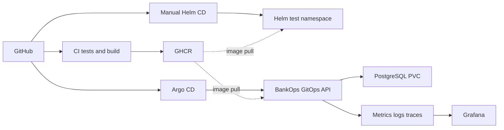

# BankOps — Banking Transaction Monitoring Platform

A hands-on **DevOps and Site Reliability Engineering (SRE) portfolio project** built around a synthetic banking transaction-monitoring API. It demonstrates how an application is built, tested, deployed, monitored, scaled and recovered in a local Kubernetes environment.

> Local production-style lab, not a live banking or production-certified system. All transactions are synthetic.

## Project at a glance

| Area | Technology / capability |
|---|---|
| Application | Python, FastAPI, PostgreSQL |
| CI and registry | GitHub Actions, pytest, Docker, GHCR SHA-tagged images |
| Deployment | Kubernetes (three-node Kind), Helm, Argo CD |
| Reliability | HPA, self-healing, probe and PDB exercises, resource troubleshooting |
| Observability | Prometheus, Grafana, Loki, Alloy, OpenTelemetry, Tempo, Alertmanager |
| SRE operations | SLI/SLO, error budgets, burn-rate alerts, incident runbooks and RCA |
| Recovery | Helm rollback, persistent storage, logical PostgreSQL backup |

## Architecture



See [architecture and release flow](docs/ARCHITECTURE.md) for details. Image publishing and image promotion are separate; GitOps uses an explicitly selected image tag.

## API functionality

| Endpoint | Purpose |
|---|---|
| GET /health | Lightweight application health response |
| GET /version | Application version |
| POST /transactions | Validate, evaluate and persist a synthetic transaction |
| GET /transactions/{transaction_id} | Retrieve stored transaction or return 404 |
| GET /metrics | Prometheus instrumentation |

The current source code applies a simple amount-based monitoring rule (100000 or more returns REVIEW; otherwise CLEAR). This is a demonstration, not a real AML detection model.

## Validation highlights — 24–26 November 2026

- GitOps application recovered to Synced/Healthy after an internal DNS/connectivity incident; precise underlying cause unconfirmed.
- API and PostgreSQL deployments ready; GitOps PVC Bound; HPA configured for 1–3 replicas at 60% CPU target.
- Prometheus scrape returned 1; Grafana dashboard panels displayed data; Loki returned recent logs; Tempo returned recent BankOps traces.
- Helm history recorded ten revisions including five rollbacks; revision 10 deployed.
- PostgreSQL backup created, catalog inspected and file availability confirmed; actual restore pending.

## Documentation

| Document | Contents |
|---|---|
| [Architecture](docs/ARCHITECTURE.md) | Request flow, build and release, runtime and trade-offs |
| [Hands-on SRE exercises](docs/sre-lab-progress-2026-11-23.md) | Probes, PDB, OOM, CPU throttling, scheduling and node maintenance |
| [Final validation](docs/FINAL_VALIDATION.md) | Observed results, incident evidence and outstanding checks |
| [Incident response runbook](docs/runbooks/BANKOPS_INCIDENT_RESPONSE.md) | Diagnosis, telemetry, recovery, backup and RCA |

## Reproduce read-only operational checks

Run against the existing configured local cluster, not an arbitrary production context:

```bash
kubectl config current-context
kubectl get applications -n argocd
kubectl get deployment,pods,svc,hpa,pvc -n bankops-gitops
kubectl get pods -n monitoring
helm history bankops-test -n bankops-helm-test
```

## Observability and SRE

Prometheus scrapes application metrics; Grafana visualizes request rates, errors and latency. Loki provides centralized log retrieval and Tempo exposes recent OpenTelemetry traces. Request-based non-5xx availability is evaluated against a 99.9% target, with error-budget consumption and fast/slow burn alerts. A successful 24-hour measurement is not evidence of continuous uptime or a full SLO window.

The practical exercises demonstrate controller recovery, container restart behavior, readiness/liveness, rolling updates, PDB eviction restrictions, OOMKilled, CPU throttling and scheduling constraints. Temporary demo workloads were used where possible; a real node drain was deliberately avoided.

## Limitations and next steps

This lab uses one physical host and a single PostgreSQL instance; it is not production HA. Full restore testing, offsite backups, notification delivery validation, additional security controls, automated image promotion and cloud infrastructure remain future work. Detailed architecture presentation and knowledge assessment will be covered in mock interviews. AI-assisted incident investigation is a planned extension, not an implemented feature.

---

## Implementation history

## CI/CD Architecture

BankOps uses two GitHub Actions workflows.

### Continuous Integration — `.github/workflows/ci.yaml`

The CI workflow runs on GitHub-hosted runners.

1. Check out the application source code.
2. Install Python dependencies.
3. Execute automated tests using pytest.
4. Build the BankOps Docker image.
5. Publish the image to GitHub Container Registry (GHCR) on pushes to `main`.

Images are tagged using the Git commit SHA for traceability.

Container registry:
`ghcr.io/rohanwadehra24/bankops`

### Continuous Deployment — `.github/workflows/deploy.yaml`

The CD workflow is manually triggered from GitHub Actions.

1. Run the deployment job on the dedicated self-hosted runner.
2. Check out the BankOps repository.
3. Authenticate to the local Kind cluster using a restricted Kubernetes ServiceAccount.
4. Execute `helm upgrade` for the `bankops-test` release.
5. Wait for Kubernetes resources to become ready.

Deployment namespace: `bankops-helm-test`

The current local-lab workflow deploys a specified, verified GHCR image tag. Image selection is not yet automatic.

### Security Considerations

The self-hosted runner runs under a dedicated Linux account named `bankopsrunner`, without membership in the `sudo` or `docker` groups.

Kubernetes access uses the `bankops-deployer` ServiceAccount with namespace-scoped RBAC.

ServiceAccount tokens are refreshed manually for supervised deployments.

Because the GitHub repository is public, this runner is used only during supervised testing and is kept offline otherwise. These controls reduce risk but do not provide complete runner isolation.


## Kubernetes Rolling Updates and Helm Rollback

### Rolling Update Validation

BankOps v1.1.0 introduced a new `GET /version` endpoint.

The updated Docker image was published to GHCR and deployed to the local Kind cluster using GitHub Actions and Helm.

Kubernetes created a new application Pod while the existing PostgreSQL Pod remained operational.

Verification commands:

```bash
kubectl rollout status deployment/bankops-test-bankops-chart \
  -n bankops-helm-test

kubectl get pods -n bankops-helm-test
```

The application endpoint returned:

```json
{"application":"BankOps","version":"1.1.0"}
```

### Helm Rollback and Recovery

We tested recovery by rolling back the BankOps Helm release to an earlier revision.

```bash
helm history bankops-test -n bankops-helm-test

helm rollback bankops-test 5 \
  -n bankops-helm-test \
  --wait --timeout 5m
```

Validation results:

- Helm created revision 7 for the rollback.
- Kubernetes successfully restored the previous application image.
- The `/version` endpoint returned HTTP 404, as expected.
- The `/health` endpoint returned `{"status":"ok"}`.
- PostgreSQL transaction `HELM-TXN-001` remained accessible.

The application was subsequently restored to v1.1.0. The active Helm revision after additional rollback exercises was revision 10.

### Database Persistence

PostgreSQL uses a Kubernetes PersistentVolumeClaim:

- PVC: `bankops-test-db-pvc`
- Storage: 1Gi
- Namespace: `bankops-helm-test`

The synthetic transaction `HELM-TXN-001` remained available through the API after application rollback.

This demonstrates application rollback with data continuity in the local lab.

Note: Helm rollback does not automatically reverse database schema migrations or restore database contents from backups.


## Argo CD and GitOps

### Architecture

BankOps uses Argo CD to deploy its Helm chart from GitHub
to a local Kind Kubernetes cluster.

GitHub -> Argo CD -> Helm rendering -> Kubernetes -> BankOps

The GitOps environment is isolated from the existing
Helm-managed deployment.

- Argo CD namespace: `argocd`
- Application namespace: `bankops-gitops`
- Application name: `bankops-gitops`
- Helm release name: `bankops-gitops`
- Git branch: `main`

### Declarative Configuration

- `gitops/application.yaml` defines the Argo CD Application.
- `gitops/values-gitops.yaml` defines environment-specific Helm values.
- `bankops-chart/` contains the Kubernetes Helm templates.

Database credentials are stored in a namespace-specific
Kubernetes Secret and are not committed to Git.

### Automatic Synchronization and Self-Healing

The Argo CD Application uses:

- Automatic synchronization: enabled
- Self-healing: enabled
- Automatic pruning: disabled

Before HPA was enabled, a controlled drift experiment changed the FastAPI Deployment
from one replica to two without modifying Git.

Argo CD automatically restored the Git-defined replica count
to one.

Kubernetes Events confirmed the scale-up and scale-down actions.

### Functional Validation

The GitOps deployment successfully passed:

- FastAPI `/health` validation
- FastAPI `/version` validation (v1.1.0)
- Synthetic transaction creation
- Transaction monitoring outcome: `REVIEW`
- PostgreSQL transaction retrieval
- Transaction persistence after FastAPI Pod restart

Test transaction: `GITOPS-TXN-001`

PostgreSQL uses the dedicated PVC `bankops-gitops-db-pvc`
with 1Gi of storage.

### Operational Lessons

Intermittent internal DNS resolution failures affected
Argo CD repository-server communication during testing.

The affected synchronization operations were investigated,
and successful reconciliation was subsequently verified.

On 25 November, synchronization recovered after the Docker Desktop recovery step. The underlying DNS timeout cause remains unconfirmed.

This deployment demonstrates local GitOps workflows.
Production use would require additional security,
high availability, backup and disaster recovery controls.
