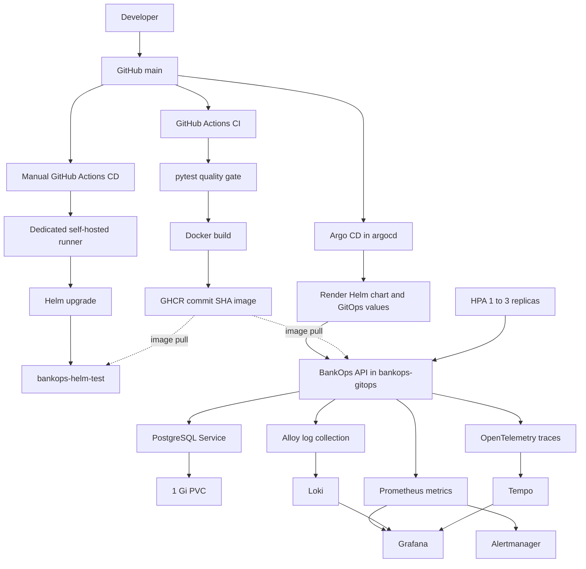

# BankOps architecture

BankOps is a synthetic banking transaction-monitoring API and a production-style SRE/DevOps portfolio lab, not a live banking system. The environment is a three-node local Kind cluster on Docker Desktop/WSL2.

## Logical architecture

Logical telemetry flow only; the diagram does not assert a specific trace transport or span instrumentation beyond observed BankOps traces.

## Application and data flow

- FastAPI exposes GET /health, GET /version, POST /transactions, GET /transactions/{transaction_id}, and /metrics.
- POST validates a transaction, evaluates a synthetic amount threshold (100000 or more: REVIEW; otherwise CLEAR), writes to PostgreSQL and returns its result.
- GET retrieves the persisted transaction or returns HTTP 404 when absent.
- SQL uses parameterized statements. /health is a lightweight process-level response, not a database readiness test.
- PostgreSQL is reached through the bankops-db ClusterIP service on 5432; the API service exposes 8000. Separate namespace-specific PVCs support persistence.

## Build and release

1. Push or PR to main triggers [CI](../.github/workflows/ci.yaml); manual runs are supported.
2. GitHub-hosted Python 3.12 runner installs dependencies and runs pytest. Docker build depends on successful tests.
3. Only pushes to main publish the image to GHCR, tagged with the commit SHA. PR builds do not push images.
4. Push-based CD: [manual deployment workflow](../.github/workflows/deploy.yaml) runs on a dedicated self-hosted runner against bankops-helm-test using Helm upgrade, wait and timeout. Image tag is explicitly pinned; no automatic selection.
5. Pull-based CD: [Argo CD Application](../gitops/application.yaml) watches main, renders bankops-chart using [GitOps values](../gitops/values-gitops.yaml), and reconciles bankops-gitops. Automated sync and self-heal enabled, prune disabled. GitOps image tag is explicitly pinned, so a new CI image alone does not deploy new code.
6. Argo CD uses Helm as a manifest renderer; it is not managing the separate Helm release history in bankops-helm-test.

## Runtime and reliability

| Layer | Configuration or demonstrated behavior |
|---|---|
| Kubernetes | 1 control plane, 2 workers; namespace isolation |
| API autoscaling | CPU target 60%, min 1, max 3; previous scale-up/down exercise |
| Self-healing | ReplicaSet replacement and kubelet container restart demonstrated |
| Probes / PDB | Readiness, liveness and voluntary disruption exercises; isolated demo workloads, not a claim of permanent production HA |
| Database | Single PostgreSQL instance, 1 Gi PVC in GitOps namespace |
| Metrics | Prometheus scrape of /metrics; request counts, latency and error indicators |
| Logs | Alloy collection, Loki storage/query, Grafana Explore |
| Traces | OpenTelemetry-instrumented BankOps traces viewed in Tempo via Grafana |
| Reliability | Request-based non-5xx SLI, 99.9% target, error budget and fast/slow burn alerts |
| Recovery | Helm rollback, Git revert for GitOps, PostgreSQL custom-format backup; full restore still pending |

## Failure domains and trade-offs

Kubernetes workload health, Argo CD sync state and end-to-end service availability are distinct. An internal DNS timeout may block reconciliation while the last deployed application remains healthy. A successful image build does not prove deployment health; a healthy Pod does not prove database connectivity; a successful scrape does not prove every transaction succeeds.

This single-host lab does not provide independent failure domains, replicated database storage, offsite disaster recovery, or production-grade security. Scaling the API alone does not eliminate database bottlenecks. See [final validation](FINAL_VALIDATION.md) and [incident runbook](runbooks/BANKOPS_INCIDENT_RESPONSE.md).

## Interview walkthrough

Explain business purpose first, then request/data flow, build and release, GitOps reconciliation, Kubernetes reliability, observability and recovery. Use actual lab evidence; distinguish application configuration from standalone exercises and prior professional production-support experience.
